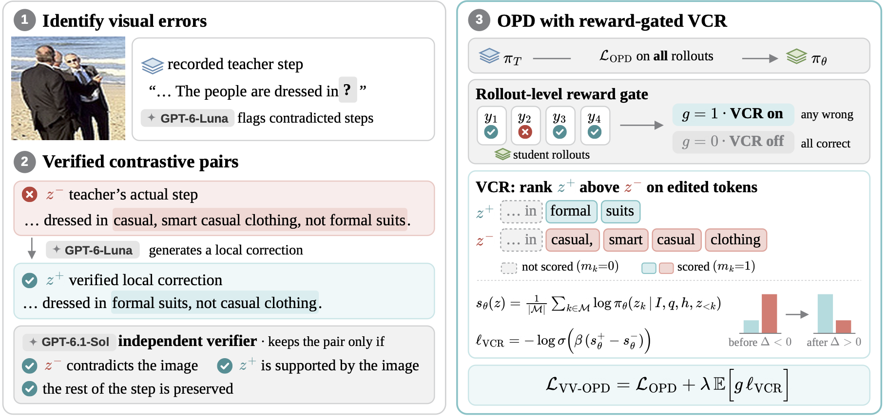

<div align="center">

<h1>Verifying Visual Claims Step by Step<br>for On-Policy Distillation</h1>

<p>
Peizhen Li<sup>1</sup> &nbsp;
Zehong Cao<sup>1</sup> &nbsp;
Yugu Li<sup>1</sup> &nbsp;
Jianglin Qiao<sup>2</sup><br>
Siyi Hu<sup>3</sup> &nbsp;
Xiao-Ming Wu<sup>4</sup> &nbsp;
Yang Zhang<sup>5</sup><br>
<sub><sup>1</sup>Adelaide University &nbsp;&nbsp;
<sup>2</sup>The University of Sydney &nbsp;&nbsp;
<sup>3</sup>Curtin University<br>
<sup>4</sup>Nanyang Technological University &nbsp;&nbsp;
<sup>5</sup>University of North Texas</sub>
</p>

<!-- Replace the arXiv badge with a linked badge when the paper is public. -->
<p>
<a href="https://lipzh5.github.io/VV-OPD/"></a>

<a href="#data-preparation"></a>
<a href="#citation"></a>
</p>

<p><em>Distilling the teacher's knowledge without inheriting its visual reasoning errors.</em></p>

</div>

**VV-OPD (Visual Verification for On-Policy Distillation)** verifies visual claims in the teacher's reasoning steps and constructs contrastive pairs to train the student policy to favor reasoning grounded in visual evidence.

## Overview

On-policy distillation can transfer a teacher's visually inconsistent intermediate reasoning to the student, even when the final answer is correct. VV-OPD mitigates this error transfer through:

- **Verified contrastive pairs** of visually consistent and inconsistent reasoning steps under a shared visual context.
- **Edit-token masking** to concentrate contrastive supervision on the corrected regions.
- **Reward gating** to activate contrastive supervision for matched questions with at least one incorrect student rollout.

The implementation is built on [veRL](https://github.com/verl-project/verl), with vLLM rollouts and FSDP training.

## Method

<div align="center">
  
  <p><em><b>Method overview.</b> Verified contrastive pair construction followed by reward-gated visual consistency ranking (VCR) on edited tokens.</em></p>
</div>

## Installation

### 1. Runtime environment

We use the following veRL container image:

```text
verlai/verl:uv.cu130
```

The reference recipe was tested on two NVIDIA H200 GPUs with Python 3.12. It uses one GPU for the student (training and rollout) and one for the teacher (inference).

**Run:ai:** create a workload using `verlai/verl:uv.cu130`, request two GPUs, and mount writable persistent storage containing the repository and training data. Inside the container, navigate to the repository root. The two GPUs must be visible as devices `0,1`.

<details>
<summary>Alternative: local Docker setup</summary>

On a Linux host with a compatible NVIDIA driver, Docker, and NVIDIA Container Toolkit, run the following from the repository root:

```bash
docker pull verlai/verl:uv.cu130

mkdir -p "$HOME/vvopd-storage"
docker run --rm -it \
  --gpus '"device=0,1"' \
  --ipc=host \
  -v "$PWD:/workspace/vvopd" \
  -v "$HOME/vvopd-storage:/scratch/projectvvopd" \
  -w /workspace/vvopd \
  -e SCRATCH_ROOT=/scratch/projectvvopd \
  --entrypoint /bin/bash \
  verlai/verl:uv.cu130
```

The Docker command is an alternative to the Run:ai deployment; it has not been independently tested. Both the repository mount and the storage mount must be writable.

</details>

### 2. Storage and dependencies

From the repository root **inside the container**, set `SCRATCH_ROOT` to your writable, persistent storage directory. For example, on Run:ai:

```bash
export SCRATCH_ROOT=/scratch/projectvvopd
```

The path above is an example, not a required cluster-specific directory. Replace it with your actual writable storage mount. Verify the environment:

```bash
nvidia-smi
uv --version
test -d "$SCRATCH_ROOT" && test -w "$SCRATCH_ROOT"
```

The launcher automatically creates the project environment in `.venv/` and installs the locked dependencies from `pyproject.toml` and `uv.lock`. It uses the equivalent of:

```bash
uv run --frozen --all-packages --extra vllm --extra fsdp python3
```

No manual Conda environment or `pip install` step is required. Use the veRL source included in this repository rather than installing a separate upstream checkout. The launcher also ensures that Ray workers use the project's Python interpreter.

The first run requires network access and sufficient persistent storage for dependencies, model weights, and checkpoints.

<details>
<summary>Cache locations and runtime details</summary>

`run.sh` configures these paths automatically:

| Location | Purpose |
| :--- | :--- |
| `$SCRATCH_ROOT/.container_home` | Writable container home |
| `$SCRATCH_ROOT/.cache/uv` | uv dependency cache |
| `$SCRATCH_ROOT/hf_cache` | Hugging Face model cache |
| `.venv/` | Project Python environment |

Ray runtime sockets use a short, local temporary path.

</details>

### 3. Experiment tracking

The current launcher uses online [Weights & Biases](https://wandb.ai/) logging with project name `vvopd`. Set `WANDB_API_KEY` through your workload's secret manager, or enter it securely in the container:

```bash
read -rsp 'W&B API key: ' WANDB_API_KEY; echo
export WANDB_API_KEY
```

Alternatively, the launcher reads the key from `../.secrets/wandb_api_key` relative to the repository root. Keep credentials outside the repository. The current launcher requires a key even in check mode.

## Data preparation

The prepared Geo3K dataset contains 2,702 training questions and 2,530 verified contrastive pairs.

🤗 **Hugging Face:** VV-OPD Geo3K Dataset (coming soon).
<!-- TODO: Add the published Hugging Face dataset URL here. -->

<details>
<summary>Download the dataset from Hugging Face</summary>

Once the dataset is released, run the following from the repository root inside the container. Replace the placeholder repository ID with the published Hugging Face dataset ID.

```bash
HF_DATASET="YOUR_HF_ORG/vvopd-geo3k"
DATA_DIR="data/train/release/geo3k2702_2530pair"

HF_HOME="$SCRATCH_ROOT/hf_cache" uvx --from huggingface_hub hf download "$HF_DATASET" \
  --repo-type dataset \
  --local-dir "$DATA_DIR"
```

The command downloads the complete dataset repository, including its image assets and integrity manifest. The release files are expected at the root of the Hugging Face dataset repository. Verify the downloaded files with:

```bash
(cd "$DATA_DIR" && sha256sum -c SHA256SUMS)
```

Expected local layout (release files):

```text
data/train/release/geo3k2702_2530pair/
├── SHA256SUMS
├── images/
├── pair_index_multi.jsonl
├── raw_source_alignment.jsonl
├── train_geo3k_qa_aligned.parquet
├── train_vcp_multi.jsonl
└── train_vcp_multi_runtime.jsonl
```

Preserve all accompanying files and their relative paths. Avoid symlinks or image references that depend on another local checkout.

</details>

The launcher verifies the prepared dataset without rebuilding or modifying the pairs. No separate validation dataset is required.

## Quick start

Run from the repository root:

```bash
# Validate the environment, dataset, interfaces, and training configuration.
bash run.sh --mode check

# Train and export the final Hugging Face checkpoint.
bash run.sh
```

The default recipe distills Qwen3-VL-8B-Instruct into Qwen3-VL-2B-Instruct with verified contrastive supervision. It does not run benchmark evaluation.

Training and export can also be executed independently:

```bash
bash run.sh --mode train
bash run.sh --mode merge
```

The default training settings are defined in `run.sh` and `vvopd/train_core.sh`. The contrastive weight and ranking scale can optionally be overridden using `--vcp-weight` and `--beta`.

## Code structure

```text
vvopd/
├── contrastive_distillation.py   # Contrastive scoring and gradient integration
├── edit_token_mask.py           # Edited-token selection
├── reward_gate.py               # Rollout-based gating
├── qwen3vl_input_alignment.py   # Multimodal input alignment
├── neutral_reward.py            # Framework reward interface
├── train_core.sh                # Training configuration
└── utils/                      # Dataset checks and checkpoint selection
verl/                           # Integrated training backend
run.sh                          # Training and export entry point
pyproject.toml                  # Project dependencies
uv.lock                         # Locked dependency versions
```

## Outputs

- `checkpoints/<experiment>/`: training checkpoints and run contract.
- `exports_final/<experiment>/global_step_840_hf/`: final Hugging Face model for the default recipe.
- `tmp/`: logs and configuration diagnostics.

Compatible runs can resume from full training checkpoints. Use a new experiment name when changing incompatible settings or migrating the training core.

## Citation

If you find VV-OPD useful in your research, please cite our work.

<!-- Replace with the official arXiv BibTeX entry after publication. -->
```bibtex
@misc{li2026vvopd,
  title  = {Verifying Visual Claims Step by Step for On-Policy Distillation},
  author = {Li, Peizhen and Cao, Zehong and Li, Yugu and Qiao, Jianglin and
            Hu, Siyi and Wu, Xiao-Ming and Zhang, Yang},
  year   = {2026}
}
```

## Acknowledgements

VV-OPD builds on [veRL](https://github.com/verl-project/verl), [vLLM](https://github.com/vllm-project/vllm), and [Qwen3-VL](https://github.com/QwenLM/Qwen3-VL).
